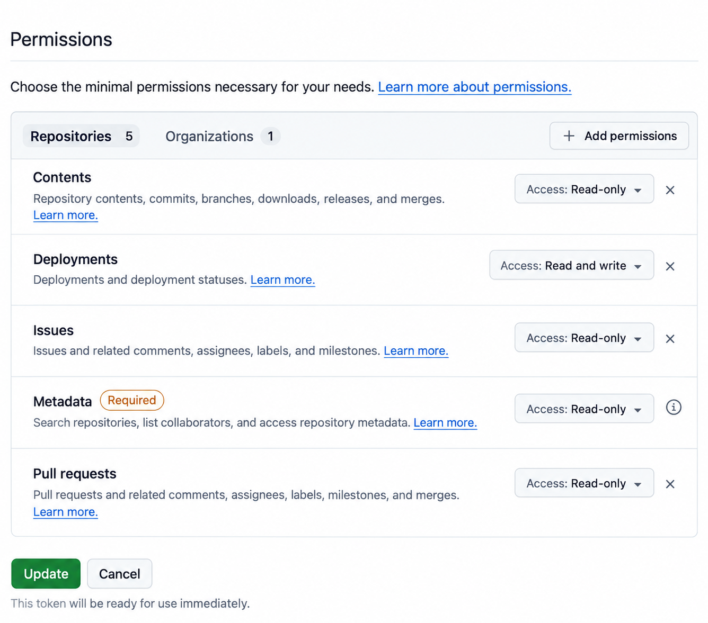
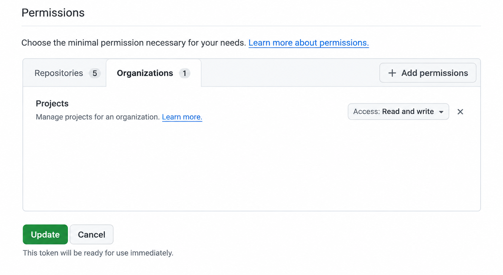

# Deployment Tracker

Synchronise les déploiements **Dokploy** avec le journal **GitHub Deployments** et les statuts des tickets dans **GitHub Projects**. Service léger en Node.js 24 et Fastify, déployable sur un VPS.

```text
Notification Dokploy → Deployment Tracker → GitHub Deployments
                                         → Statuts du backlog GitHub Projects
```

Le service conserve le commit, le résultat et les dates Dokploy de chaque déploiement. API et frontend partagent une seule entrée par **environnement et commit** (`staging`, `test`, `preprod`). Un redéploiement du même commit met à jour le résultat de cette entrée.

## Installation

Prérequis : **Node.js 24** et **pnpm 10**.

```bash
pnpm install --frozen-lockfile
cp .env.example .env
cp config.example.json config.json
openssl rand -hex 32
```

Utiliser la clé générée comme `WEBHOOK_SECRET`, puis renseigner `.env` :

| Variable | Usage |
| --- | --- |
| `DOKPLOY_URL` | URL de l’instance Dokploy |
| `DOKPLOY_API_KEY` | Accès aux historiques des services suivis |
| `GITHUB_TOKEN` | Token du dépôt cible, **Deployments → Read and write** |
| `GITHUB_PROJECT_TOKEN` | Facultatif : token dédié au backlog ; sinon `GITHUB_TOKEN` est utilisé |
| `WEBHOOK_SECRET` | Secret partagé avec la notification Dokploy |
| `DRY_RUN` | `true` pour simuler, `false` pour écrire dans GitHub |
| `SYNC_INTERVAL_SECONDS` | Intervalle de rattrapage, `86400` par défaut ; `0` désactive le timer |

Dans `config.json`, déclarer les services à suivre :

```json
{
  "targets": [
    {
      "type": "application",
      "id": "ID_APPLICATION_DOKPLOY",
      "service": "api",
      "repository": "owner/repository",
      "environment": "test",
      "environmentUrl": "https://api.example.com"
    }
  ]
}
```

`type` accepte `application` ou `compose` ; `id` correspond à l’identifiant Dokploy. `environmentUrl` est facultatif. Ajouter `production: true` pour la production. Chaque cible doit avoir un identifiant distinct et une combinaison dépôt/environnement/service unique. Ne pas inclure Deployment Tracker lui-même.

## Synchronisation

```bash
# Vérifier la syntaxe et simuler l’import
pnpm check
pnpm test
pnpm sync --dry-run

# Importer depuis une date
pnpm sync --since 2026-09-01

# Importer un seul déploiement Dokploy
pnpm sync --target ID_APPLICATION_DOKPLOY --deployment ID_DEPLOIEMENT_DOKPLOY

# Démarrer le serveur sur le port 3000
pnpm start
```

Ajouter `--dry-run` à une commande pour la simuler. `DRY_RUN=true` dans `.env` impose aussi la simulation. Les imports existants sont reconnus pour éviter les doublons. Le filtre `--since` utilise la dernière date de fin du groupe, ou la date de création si elle manque. `--target` sélectionne l’environnement complet du service ; `--deployment` limite au commit de cette tentative, en consultant aussi les autres services attendus.

> [!IMPORTANT]
> Le serveur synchronise tout l’historique disponible au démarrage, puis à chaque notification et toutes les 24 heures par défaut. Arrêter le serveur avant un import manuel : une seule instance doit utiliser le fichier d’état.

## Notification Dokploy

Dans **Settings → Notifications → Custom**, configurer :

| Champ | Valeur |
| --- | --- |
| Webhook URL | `https://tracker.example.com/webhooks/dokploy` |
| Header | `Authorization: Bearer <WEBHOOK_SECRET>` |
| Actions | **App Deploy** et **App Build Error** |

**Test Notification** vérifie la réception sans lancer d’import. Les notifications `type=build` et `status=success/error` déclenchent une lecture de l’historique Dokploy ; le rattrapage périodique couvre les notifications manquées.

Pour tester localement : `ngrok http 3000`, puis utiliser l’URL du tunnel suivie de `/webhooks/dokploy`.

## Suivi des tickets dans GitHub Projects

Le tracker suit les PR de fonctionnalité fusionnées vers `dev`, y compris les PR d'une pile GitHub dont la branche cible est `dev`, puis promues par **merge commits de `dev` vers `test`, puis de `test` vers préproduction**. La comparaison GitHub vérifie que le commit de fusion de chaque PR est un ancêtre du commit réellement déployé ; le dernier commit seul ou le titre d’une PR ne suffisent pas. Une promotion par squash ou rebase peut modifier l'historique et empêcher cette preuve.

```text
PR feature ── squash ──> dev / STAGING
                            │
                        PR dev → test, merge commit
                            ↓
                        test / TEST
                            │
                        PR test → préproduction, merge commit
                            ↓
                        préproduction / PREPROD
```

Le projet suivi est [2i Group - Studio, n° 41](https://github.com/orgs/drakkr-team/projects/41). Le champ `Status` est commun aux vues du projet : les vues Features et Bugs reflètent les mêmes déplacements. Aucune automatisation native du projet n’est créée ou modifiée ; les règles sont exécutées par ce service.

### Configuration à ajouter

Ajouter le bloc suivant à la racine du `config.json` existant, **en conservant le tableau `targets` et ses identifiants Dokploy** :

```json
{
  "backlog": {
    "enabled": true,
    "organization": "drakkr-team",
    "projectNumber": 41,
    "field": "Status",
    "repositories": { "drakkr-team/2i-group-studio": "dev" },
    "ignoredRepositories": ["drakkr-team/2i-group-odoo"],
    "initialStatuses": ["À clarifier", "Backlog", "Ready", "In progress", "In review"],
    "protectedStatuses": ["Closed", "Canceled"],
    "stages": [
      { "environment": "staging", "status": "In STAGING" },
      { "environment": "test", "status": "In TEST" },
      { "environment": "preprod", "status": "In PREPROD" },
      { "environment": "production", "status": "In PROD" }
    ]
  }
}
```

Ce bloc est aussi fourni dans `config.example.json`, avec `enabled: false` par défaut. `repositories` associe chaque dépôt à la branche cible des PR de fonctionnalité (`dev`). `stages` définit, dans l’ordre croissant, la correspondance environnement/statut. Les noms d’environnement doivent correspondre à ceux des `targets` et les noms de statuts à ceux du projet, majuscules comprises.

`ignoredRepositories` permet d'ignorer les PR du dépôt Odoo : seul le déploiement Studio est vérifié, sans garantie que les changements Odoo soient livrés. Le token doit pouvoir lire les PR Odoo pour que GitHub identifie leur dépôt. Les PR inaccessibles restent bloquantes, et au moins une PR d'un dépôt suivi est nécessaire.

| Environnement Dokploy configuré | Statut cible |
| --- | --- |
| `staging` | `In STAGING` |
| `test` | `In TEST` |
| `preprod` | `In PREPROD` |
| `production` | `In PROD`, uniquement si des cibles de production sont ajoutées |

Le setup actuel suit l’API et le frontend de STAGING, TEST et PREPROD. La présence de `production` dans `stages` permet de reconnaître les tickets déjà en `In PROD` et d’éviter de les rétrograder ; elle ne crée pas de cible de production. Pour suivre la production, ajouter ses services dans `targets` avec `environment: "production"` et `production: true`.

### Permissions du token GitHub

Ouvrir [Fine-grained personal access tokens](https://github.com/settings/personal-access-tokens), puis éditer le token utilisé par le tracker ou en créer un. Le chemin est **Settings → Developer settings → Personal access tokens → Fine-grained tokens**.

Choisir **Resource owner : `drakkr-team`**, puis **Repository access → Only select repositories → `2i-group-studio`**. Configurer les permissions suivantes :

| Onglet | Permission | Accès |
| --- | --- | --- |
| Repositories | Contents | Read-only |
| Repositories | Deployments | Read and write |
| Repositories | Issues | Read-only |
| Repositories | Metadata | Read-only, obligatoire automatiquement |
| Repositories | Pull requests | Read-only |
| Organizations | Projects | Read and write |

**Repositories :**



**Organizations :** cliquer sur cet onglet avant **Add permissions** pour trouver **Projects**. Cette permission n’apparaît pas dans la recherche des permissions de dépôt.



Les visuels ci-dessus sont des illustrations recadrées à partir des captures de configuration, sans les éléments personnels du navigateur.

Cliquer sur **Update** ou **Generate token**. Si le token est en attente d’approbation, un propriétaire doit l’approuver dans les paramètres de l’organisation, **Personal access tokens → Pending requests**.

Le setup validé le 7 octobre 2026 utilise **le même `GITHUB_TOKEN` pour Deployments et Projects**, avec ces permissions. Si ce token est déjà configuré dans Dokploy et que seules ses permissions ont été modifiées, sa valeur reste la même : aucune nouvelle variable n’est nécessaire.

Pour utiliser un token distinct, renseigner `GITHUB_PROJECT_TOKEN` dans `.env` en local et dans les variables de l’application Dokploy. Il prend la priorité pour le backlog seulement ; `GITHUB_TOKEN` reste utilisé pour Deployments. Le token dédié n’a pas besoin de la permission Deployments. Même une simulation du backlog nécessite un accès GitHub en lecture.

### Règles de déplacement

À chaque synchronisation, le tracker examine les issues déjà présentes dans le projet, y compris les issues GitHub fermées dont le statut du projet est encore actif. Pour les issues sans sous-issues, il récupère les PR explicitement liées et avance le statut jusqu’au plus haut environnement prouvé :

- Toutes les PR liées non abandonnées doivent être fusionnées vers la branche configurée, directement ou dans une pile GitHub qui la cible. Une PR fermée sans fusion est ignorée ; une PR encore ouverte bloque le ticket.
- Pour un même dépôt, tous les commits nécessaires doivent être inclus dans **une même version** dont chaque service configuré a réussi. Pour plusieurs dépôts, chacun doit avoir une preuve dans le même environnement.
- Les simples mentions de tickets, les PR de promotion directement liées, les dépôts non configurés et les liens inaccessibles ne constituent pas une preuve exploitable.
- Si GitHub renvoie une PR liée inaccessible, le ticket reste en place avec le motif `inaccessible_pr` ; vérifier l'accès du token aux dépôts concernés.
- Les tickets archivés, `Closed`, `Canceled` ou avec un statut non configuré sont ignorés. Un ticket n’est jamais rétrogradé.
- Le statut et les liens sont relus avant écriture. En cas d’échec, le ticket sera réévalué à la prochaine synchronisation, même si GitHub Deployments était déjà à jour.

Une issue parente suit le statut de déploiement le moins avancé de ses sous-issues directes, sans utiliser ses propres PR. Toutes ses sous-issues doivent être présentes dans le projet, actives et au moins en `In STAGING`. Les parents imbriqués sont traités des enfants vers les parents. Les statuts protégés et la règle de non-rétrogradation s’appliquent aussi aux parents. Le tracker relit les sous-issues et leurs statuts avant de déplacer un parent.

Seul le champ `Status` du projet est modifié. Le tracker ne ferme pas d’issues, n’ajoute pas de tickets au projet, ne déplace pas les cartes de PR et ne change ni les labels ni les autres champs. Il peut avancer directement de `In STAGING` à `In PREPROD` si la livraison en préproduction est prouvée.

Le premier démarrage avec le suivi actif enregistre une date d’activation dans l’état persistant. Seuls les déploiements terminés depuis cette date servent au suivi courant ; les livraisons plus anciennes sont réservées au rattrapage explicite. Conserver le volume d’état pour préserver cette date et l’historique des tentatives.

### Rattrapage du backlog existant

La commande `backfill` consulte Dokploy et l’état local, puis vérifie les commits des PR liées aux tickets. **Elle simule par défaut**, même si `DRY_RUN=false`.

```bash
# Produire un rapport avec statuts actuels/proposés et preuves de livraison
pnpm backfill --report data/backfill-simulation.json

# Restreindre les preuves à des déploiements récents, si nécessaire
pnpm backfill --since 2026-09-01 --report data/backfill-simulation.json

# Appliquer après vérification du rapport
DRY_RUN=false pnpm backfill --apply --report data/backfill-applied.json
```

`--target` et `--deployment` ont le même sens que pour `sync` : un service sélectionne toujours son environnement complet. Les filtres limitent les preuves disponibles, pas la liste des tickets examinés. `--apply` est refusé avec `--dry-run` ou `DRY_RUN=true`.

Le rattrapage modifie uniquement le champ du projet : il ne crée pas de GitHub Deployments, ne ferme pas les issues et n’écrit pas dans le fichier d’état. Le rapport contient les PR, leurs commits de squash, la version déployée, les résultats des services et le motif de chaque ticket laissé en place. Une relance réévalue les statuts et ne répète pas les déplacements déjà effectués. Un historique Dokploy inaccessible bloque les écritures du backlog pour cette exécution.

Le statut représente le **plus haut environnement atteint avec une preuve conservée**, et non une garantie que la fonctionnalité y est toujours active. Les rollbacks et les reverts ne rétrogradent pas automatiquement les tickets. Les cherry-picks ou squashes entre environnements ne préservent pas cette preuve d’ascendance et demandent un traitement manuel. Un historique incomplet, une PR déliée ou un commit supprimé peut empêcher le rattrapage.

### Rattrapage effectué le 7 octobre 2026

Après simulation, le rattrapage a examiné **66 issues** du projet sur l’historique disponible de STAGING, TEST et PREPROD. Il a déplacé **19 tickets en `In PREPROD`**, avec vérification des statuts dans GitHub après écriture et **aucune erreur**. Les preuves correspondent au déploiement réussi de l’API et du frontend le **5 octobre 2026**, commit `312c53d1c8ca28cc8c26930ef8001a0bbca9705f`.

| Statut avant rattrapage | Tickets passés en `In PREPROD` |
| --- | --- |
| `In STAGING` | #837, #838, #839, #840, #841, #842 |
| `In TEST` | #793, #794, #843, #844, #845, #846, #847, #850, #853, #890, #894, #895, #907 |

Les **47 autres tickets** sont restés en place :

| Motif | Nombre |
| --- | --- |
| Aucune PR liée exploitable | 41 |
| PR non fusionnée | 2 |
| PR ne ciblant pas la branche configurée | 1 |
| Aucune preuve d’un environnement plus avancé | 1 |
| Statut protégé `Closed` ou `Canceled` | 2 |

Les rapports locaux se trouvent dans `data/backfill-simulation.json` et `data/backfill-applied-2026-10-07.json`. Ils sont exclus de Git et ne sont pas livrés dans l’image Docker. Ce bilan décrit l’opération du 7 octobre, pas les statuts actuels du projet. La production n’a pas été examinée, faute de cible configurée.

Le rattrapage a été exécuté depuis le poste local. Il ne déploie pas le tracker et n’active pas le suivi sur le serveur : suivre les étapes ci-dessous pour les livraisons suivantes.

### Activation sur l’application Dokploy existante

1. Préparer cette version du code pour la branche utilisée par l’application `deployment-tracker`. Si un push déclenche le déploiement, préparer d’abord les fichiers et variables ci-dessous.
2. Ajouter le bloc `backlog` avec `enabled: true` au **fichier monté sur `/app/config.json`**. Le fichier local et `config.example.json` ne remplacent pas automatiquement ce fichier sur le serveur. Conserver les cibles API et frontend existantes.
3. Vérifier que le `GITHUB_TOKEN` du serveur est celui dont les permissions ont été mises à jour, ou définir `GITHUB_PROJECT_TOKEN` pour un accès séparé.
4. Passer **`DRY_RUN=false` dans les variables Dokploy** pour autoriser les mises à jour. Conserver `DOKPLOY_URL`, `DOKPLOY_API_KEY`, `WEBHOOK_SECRET` et la notification existante.
5. Conserver le volume monté sur `/app/data`, inscriptible par l’utilisateur Node, et les chemins `CONFIG_FILE=/app/config.json` et `STATE_FILE=/app/data/state.json`. Utiliser une seule instance et une mise à jour **stop-first**, puis livrer le code, reconstruire et redéployer l’application.
6. Contrôler les logs au redémarrage : `backlog_activated` indique la date de départ du suivi, puis `backlog_complete` donne le résultat. Au prochain déploiement réussi, `backlog_updated` indique les tickets avancés.

Les fichiers `.env` et `config.json` locaux sont ignorés par Git : pousser le code seul ne transfère donc pas le setup local. Pour éviter une période sans suivi, préparer la configuration et le token sur le serveur avant de démarrer la nouvelle version. En cas de livraison survenue avant cette activation, relancer un rattrapage après vérification du rapport ; les tickets déjà au bon statut ne sont pas déplacés à nouveau.

### Vérification et diagnostic

```bash
pnpm check
pnpm test
pnpm backfill --dry-run --report data/backfill-simulation.json
```

Les tests couvrent notamment les promotions conservant les commits de squash, les déploiements partiels, les tickets à plusieurs PR, les statuts protégés, la pagination, la simulation sans écriture et les reprises après erreur. Les commandes `sync` et `backfill` renvoient un code de sortie non nul en cas d’erreur.

| Événement ou erreur | Signification / action |
| --- | --- |
| `backlog_would_update` | Simulation : déplacement proposé, non appliqué |
| `backlog_updated` | Statut modifié dans GitHub Projects |
| `backlog_skipped` | Ticket laissé en place ; consulter `reason` |
| `backlog_failed` | Échec d’un ticket ou de la synchronisation du projet |
| `FORBIDDEN` | Vérifier le propriétaire du token, l’accès au projet et son éventuelle approbation |
| `INSUFFICIENT_SCOPES` | Token sans droit d’écriture Projects ; une connexion locale avec `read:project` seul ne suffit pas |
| `access_blocked` | Appels suivants interrompus pour cette exécution après un refus d’accès ou une limite API |

Après correction des permissions, relancer le rattrapage ou attendre la prochaine synchronisation courante. Le suivi Projects est réessayé indépendamment des entrées Deployments déjà enregistrées.

## Déploiement sur le VPS

Après configuration, passer à `DRY_RUN=false` :

```bash
docker compose up -d --build
docker compose logs -f tracker
```

Le fichier Compose monte `config.json` et un volume persistant pour l’état. Son port est publié sur `127.0.0.1:3000` ; le rendre accessible via un reverse proxy HTTPS.

Pour une **Application Dokploy**, construire le Dockerfile, fournir les variables d’environnement, monter `config.json` sur `/app/config.json` et un volume sur `/app/data`, inscriptible par l’utilisateur Node (UID 1000). Configurer le domaine sur le port interne **3000** et mettre à jour l’URL de notification. `.env` et la configuration ne sont pas inclus dans l’image.

`GET /health` vérifie que le serveur écoute. Les résultats et erreurs de synchronisation sont disponibles dans les logs.

## Résultats regroupés

- **Succès** : la dernière tentative de chaque service configuré pour ce commit a réussi.
- **Échec** : au moins un service a échoué ou a été annulé, même si un autre manque encore.
- **Aucun résultat intermédiaire** : tant que le groupe est incomplet ou qu’un service est en cours sans échec, aucune nouvelle entrée ni statut n’est publié. Lors d’une nouvelle tentative, le dernier résultat final reste affiché jusqu’au suivant.

La dernière tentative de chaque service est conservée dans le volume, y compris les tentatives en cours, pour éviter de reprendre un ancien succès après un échec ou pendant un redéploiement. Un groupe est défini par les services du même dépôt et environnement dans `config.json` : déclarer seulement les services réellement attendus pour cette livraison.

GitHub conserve les résultats successifs comme statuts de **la même entrée**. Les logs distinguent `created`, `updated`, `recovered` et `unchanged` ; `waiting` compte les groupes sans résultat final et `failed` les erreurs de synchronisation.

## Compatibilité et limites

- L’ancien fichier d’état est migré automatiquement et sauvegardé dans `data/state.json.v1.bak` avant toute écriture. Pour un commit déjà enregistré, le script reprend une entrée existante, sans créer une troisième ligne. Les anciennes lignes séparées restent dans le journal ; cette version ne les supprime pas.
- Une seule instance doit fonctionner à la fois. Dans Dokploy Swarm, utiliser une mise à jour **stop-first** pour éviter un chevauchement de l’ancienne et de la nouvelle instance pendant le déploiement.
- Seul l’historique encore conservé dans Dokploy ou le volume local est récupérable. Les previews et entrées sans commit exact sont ignorées.
- GitHub affiche la date d’import. Le `payload` conserve les services et dates à la création de l’entrée et ne peut pas être modifié ; après un redéploiement, utiliser les descriptions des statuts et `data/state.json` pour les résultats et dates actualisés. Une entrée héritée conserve son ancien `payload` par service.
- `success` correspond au résultat Dokploy, sans contrôle supplémentaire de santé de l’application. Le service ne gère pas la désactivation des anciennes entrées GitHub.
- La génération du PV mensuel n’est pas encore implémentée.
- Conserver les secrets dans `.env` ou les variables Dokploy ; `.env` et `data/` sont exclus de Git et de l’image Docker.
